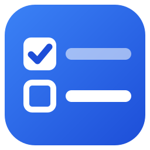
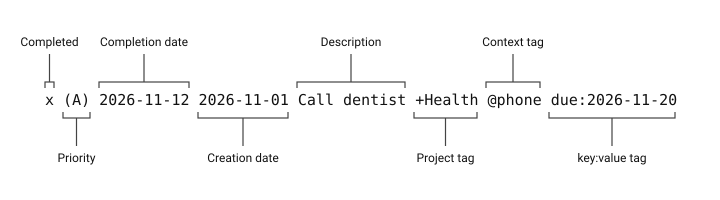
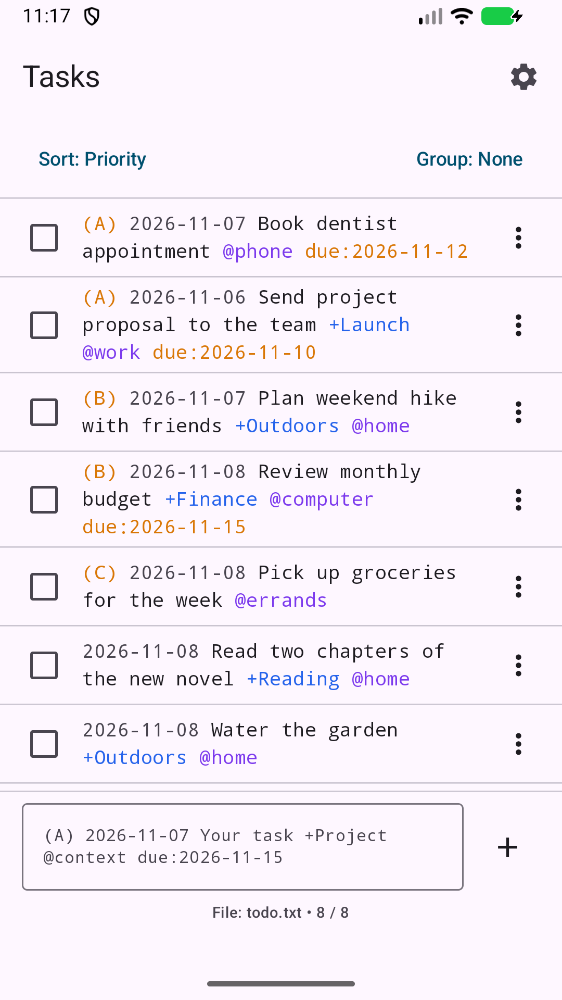
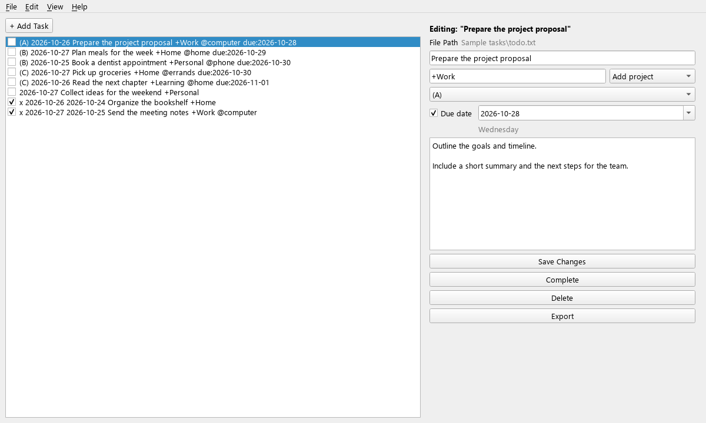

<!-- last_updated: 2026-11-13 -->

<!-- Authoring guidance: dev-docs/specs/README_SPEC.instructions.md -->
<!-- rumdl-disable MD033 MD041 -->

  

<h1 align="center">Plain Todo</h1>

  Manage everyday tasks in readable todo.txt files on Android, Windows, and iPhone.

  
  
  
  

<!-- rumdl-enable MD033 MD041 -->

---

## About

**Development status:** The Android app is available on
[Google Play](https://play.google.com/store/apps/details?id=com.plaintxtoffice.plaintodo).
The Windows and iPhone versions are still in development and have no public
download yet.

Plain Todo keeps your tasks in plain text that you can read and edit with other
todo.txt applications. Add priorities, projects, contexts, and due dates, then
complete tasks or move them into a separate archive.

<!-- rumdl-disable MD033 -->

  

<!-- rumdl-enable MD033 -->

Your list stays in a file you control. Every app can keep it on the device or
connect directly to Dropbox. Android also opens a file you choose with the
system file picker, Windows works with a local file, and iPhone supports Files
and iCloud Drive. Each platform provides its own controls for working with the
same readable task format. There is no account to create and no advertising.

## Features

- **Plain-text tasks:** Keep one task per line, with optional priorities,
  dates, `+Project` tags, and `@context` tags.
- **Everyday editing:** Add, edit, complete, reopen, and delete tasks, with a
  confirmation before deletion.
- **Flexible organization:** Sort tasks by priority or due date, and group
  them by priority, due date, project, or context. Windows also sorts by
  project or context.
- **Archives and exports:** Move completed tasks to `done.txt` and export a
  plain-text copy of your task list.
- **Direct Dropbox access:** Connect each device to the same file, with
  server revision checks that stop conflicting saves.
- **Your own file (Android and iPhone):** Open an existing todo.txt through
  the system file picker, or keep the list in the app.
- **Task details and date editing (Android and iPhone):** View a task's dates
  and related tasks, and set due and threshold dates with calendar controls.
- **Notes (Windows, in development):** Keep optional task notes locally
  alongside the app's data.
- **iCloud Drive (iPhone, in development):** Use the app's iCloud Drive
  location.
- **Recurring tasks (Windows, premium, in development):** Weekly, monthly, and
  quarterly routines kept in Markdown templates, for a paid premium edition.
  Paid-subscription activation is not currently available.

## App Screenshot

### Android

<!-- rumdl-disable MD033 -->

  

<!-- rumdl-enable MD033 -->

### Windows (in development)

<!-- rumdl-disable MD033 -->

  

<!-- rumdl-enable MD033 -->

## Download

| Platform | Download | Notes |
| --- | --- | --- |
| Android | [Google Play](https://play.google.com/store/apps/details?id=com.plaintxtoffice.plaintodo) | Free. Requires Android 8.0 or later. |

Windows and iPhone downloads will be listed here when those apps are released.

## User Manual

Read the [User Manual](docs/USER_MANUAL.md) for installation and initial setup,
daily tasks, platform-specific settings, file formats, shortcuts, and
troubleshooting.

## Feedback

Bug reports and feature requests are welcome. In the Android app, open
**Settings** and tap **Send feedback**. You can also use the
[contact form](https://plaintxtoffice.com/contact/) on plaintxtoffice.com.

## Source and License

Plain Todo is proprietary software owned by Plain Text Office LLC. Source
code is maintained privately and is not published. See [LICENSE](LICENSE) for
the applicable terms. Third-party components retain their own licenses.
