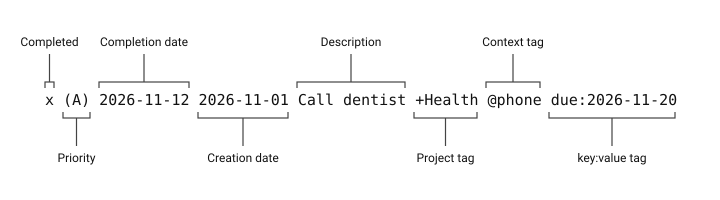

# User Manual

## Overview

Plain Todo is for people who want a graphical task list they can also read and
edit as UTF-8 plain text. Each task occupies one line of a todo.txt file. Every
Plain Todo app adds, edits, completes, deletes, sorts, groups, archives, and
exports tasks through a graphical interface. There is no command-line
interface.
<!-- Verified from: platform/android/app/src/main/kotlin/com/plaintxtoffice/plaintodo/ui/TodoAppScreen.kt; platform/windows/plain_todo/ui/gui/views/menu_bar/main_menu.py; platform/ios/plain_todo/ContentView.swift -->

| Platform | Status |
| --- | --- |
| Android | Released on Google Play. |
| Windows | In development. No public download yet. |
| iPhone | In development. No public download yet. |
<!-- Verified from: platform/android/app/build.gradle.kts; https://play.google.com/store/apps/details?id=com.plaintxtoffice.plaintodo -->

The Windows and iPhone instructions in this manual describe those apps as they
are being built. Details can change before they are released.

Every app can keep its tasks on the device or connect directly to Dropbox.
Android also opens a file you choose with the system file picker. Windows
works with a local file. iPhone supports app storage, a file imported through
Files, or the app's iCloud Drive location. Windows notes are separate local
data; they do not travel with your ordinary task file.
<!-- Verified from: platform/android/app/src/main/kotlin/com/plaintxtoffice/plaintodo/storage/TodoStorage.kt; platform/android/app/src/main/kotlin/com/plaintxtoffice/plaintodo/storage/TodoFileStore.kt; platform/windows/plain_todo/bootstrap.py; platform/windows/plain_todo/config/path_handler.py; platform/ios/plain_todo/Storage/TodoFileStore.swift; platform/ios/plain_todo/Storage/TodoStorage.swift -->

## Installation and Setup

### Check the requirements

| Platform | Verified requirements |
| --- | --- |
| Android | Android 8.0 or later. |
| Windows | A writable data location. A minimum Windows version has not been set. |
| iPhone | iOS 18.5 or later. The app target is configured for iPhone. |
| Direct Dropbox on any platform | Internet access, a Dropbox account, and an existing task file in Dropbox. Plain Todo includes its app identity. |
<!-- Verified from: platform/android/app/build.gradle.kts [minSdk]; platform/windows/plain_todo/config/path_handler.py; platform/ios/plain_todo.xcodeproj/project.pbxproj; docs/DROPBOX.md -->

### Install on Android

1. Open
   [Plain Todo on Google Play](https://play.google.com/store/apps/details?id=com.plaintxtoffice.plaintodo)
   on your Android device.
1. Tap **Install**.
1. Open the app and choose how to start, as described under
   [Choose a file on Android](#choose-a-file-on-android).

The app is free. It asks for no account and needs no permissions beyond
internet access, which is used only for an optional Dropbox connection.
<!-- Verified from: https://play.google.com/store/apps/details?id=com.plaintxtoffice.plaintodo; platform/android/app/src/main/AndroidManifest.xml -->

### Check Windows and iPhone availability

The Windows and iPhone apps are in development. There is no public installer
or App Store listing yet, so there are no installation steps for them.
<!-- Verified from: README.md; docs/DROPBOX.md -->

### Choose your first task file

#### Choose a file on Android

1. On first launch, read **Choose how to start**.
1. Tap **Start with local todo.txt** to keep your list in the app's own
   storage. An empty list starts with three sample tasks that you can edit or
   delete.
1. Or tap **Import existing .txt file** and select your file in the system
   file picker.
1. After importing, **Link done.txt** asks where completed tasks should be
   archived. Choose **Select Existing done.txt**, **Create New done.txt**, or
   **Skip**.

Importing selects the file you chose as the working file; later changes are
saved directly to it. If you skip linking an archive, archived tasks are
stored in the app.
<!-- Verified from: platform/android/app/src/main/kotlin/com/plaintxtoffice/plaintodo/ui/sheets/FirstLaunchDialog.kt; platform/android/app/src/main/kotlin/com/plaintxtoffice/plaintodo/ui/TodoAppScreen.kt; platform/android/app/src/main/kotlin/com/plaintxtoffice/plaintodo/viewmodel/TodoListViewModel.kt [seedStarterTasksIfNeeded]; platform/android/app/src/main/kotlin/com/plaintxtoffice/plaintodo/storage/TodoFileStore.kt -->

#### Choose a file on Windows

1. Open **Edit > Settings...**.
1. Use **Browse...** beside **Todo file** to select an existing text file.
1. Click **Save**.
1. Restart Plain Todo when prompted.

Create an empty UTF-8 `todo.txt` in your chosen folder first if you want to
start a new list. The default location is `data/todo.txt` under the app's data
root. A missing local file triggers a prompt to locate it.
<!-- Verified from: platform/windows/plain_todo/ui/gui/views/settings/settings_dialog.py; platform/windows/plain_todo/config/settings.py; platform/windows/plain_todo/ui/gui/views/root_window/window.py -->

#### Choose a file on iPhone

1. On first launch, choose local storage or **Import existing .txt file**.
1. For an existing list, select its file in the system picker.
1. If prompted to **Link done.txt**, choose **Select Existing done.txt**,
   **Create New done.txt**, or **Skip**.

Import selects the working file; later changes are saved directly to it. If you
skip linking an external archive, completed tasks use an archive in app storage.
<!-- Verified from: platform/ios/plain_todo/Views/Sheets.swift [FirstLaunchSheet]; platform/ios/plain_todo/ContentView.swift; platform/ios/plain_todo/Storage/TodoFileStore.swift [archiveURL] -->

### Connect directly to Dropbox

A direct connection is optional. It opens an existing task file in your Dropbox
account; it does not upload or move the list you are using. The
[Dropbox guide](DROPBOX.md) covers saving, reloading, archiving, and
disconnecting in detail.
<!-- Verified from: docs/DROPBOX.md -->

#### Connect Android to Dropbox

1. Tap the gear button to open **Settings**, then tap **Dropbox Connection…**.
1. Enter the **Dropbox todo file** and **Dropbox archive file**, for example
   `/documents/todo/todo.txt` and `/documents/todo/done.txt`. Use Dropbox
   paths starting with `/`, not a path on your device or a sharing link. The
   two files must be different.
1. Tap **Connect Dropbox…** and approve access in your browser. It returns to
   the app automatically.
1. The app checks the task file and opens it immediately.

To change the paths later, edit them and tap **Save File Paths**. To go back,
tap **Disconnect and use previous file**. This removes the saved connection,
asks Dropbox to revoke its access, and restores your previous file without
deleting anything in Dropbox.
<!-- Verified from: platform/android/app/src/main/kotlin/com/plaintxtoffice/plaintodo/ui/sheets/DropboxConnectionDialog.kt; platform/android/app/src/main/kotlin/com/plaintxtoffice/plaintodo/api/dropbox/DropboxError.kt; platform/android/app/src/main/kotlin/com/plaintxtoffice/plaintodo/storage/TodoStorage.kt [connectDropbox, disconnectDropbox] -->

The connection is encrypted with an Android Keystore key and kept in the app's
private storage. It is not written into task files or exports. There is no
offline queue or local copy of the Dropbox task file, so an internet
connection is required while connected.
<!-- Verified from: platform/android/app/src/main/kotlin/com/plaintxtoffice/plaintodo/storage/dropbox/DropboxCredentials.kt; platform/android/app/src/main/kotlin/com/plaintxtoffice/plaintodo/ui/sheets/PrivacyPolicyDialog.kt; platform/android/app/src/main/kotlin/com/plaintxtoffice/plaintodo/storage/dropbox/DropboxTaskStore.kt -->

#### Connect Windows to Dropbox

1. Prepare an existing UTF-8 task file in Dropbox and choose a different archive
   path. For example, use `/documents/todo/todo.txt` and
   `/documents/todo/done.txt`.
1. Open **File > Dropbox Connection...**.
1. Enter the **Dropbox todo file** and **Dropbox archive file**.
   Use Dropbox paths, not a local synced-folder path or sharing URL.
1. Click **Connect Dropbox…** and approve access in your browser. It returns
   automatically and Plain Todo verifies and saves the connection.
1. Restart Plain Todo. If a path needs correction, edit it and click **Save**
   before restarting; sign-in is retained while the dialog stays open.

No API key or copied authorization code is needed. Connecting validates the
existing remote task file; it does not upload or move your local list.
The archive may be created on the first archive operation, but its parent
folder must exist.
<!-- Verified from: docs/DROPBOX.md; platform/windows/plain_todo/ui/gui/views/settings/dropbox_dialog.py -->

Dropbox credentials are stored in Windows Credential Manager. Settings contain
a credential reference, not the refresh token. A portable copy moved to another
computer needs to connect again.
<!-- Verified from: docs/DROPBOX.md -->

#### Connect iPhone to Dropbox

1. Open **Settings > Dropbox Connection…**.
1. Enter the **Dropbox todo file** and **Dropbox archive file**, using the same
   paths on every device that shares the list.
1. Tap **Connect Dropbox…** and approve in the system browser. It returns
   automatically. The app checks the existing task file, then opens it
   immediately without moving or uploading your previous list.
1. To correct or change the paths after signing in, use **Save File Paths**.

The connection is stored in this device's Keychain. Task edits wait for the
server reply. A failed edit stays in the edit sheet; a failed addition keeps the
input text. If another device changed the file, or the result of a save is
uncertain, the app reloads the latest list; review it and reapply the intended
change if it is still missing. A save that never reached Dropbox leaves the
list unchanged. There is no offline queue or local mirror of the remote task
file.
<!-- Verified from: platform/ios/plain_todo/Views/DropboxConnectionSheet.swift; platform/ios/plain_todo/Storage/Dropbox/DropboxCredentials.swift; platform/ios/plain_todo/Storage/Dropbox/DropboxTaskStore.swift; platform/ios/plain_todo/ViewModels/TodoListViewModel.swift [save]; platform/ios/plain_todo/Views/Sheets.swift; platform/ios/plain_todo/ContentView.swift -->

Local-file and iCloud selection controls are disabled while directly connected.
To return, choose **Disconnect and use previous file** in the connection screen.
This removes the saved connection, asks Dropbox to revoke its authorization,
and restores the previous file selection without deleting Dropbox files. The
connection is removed even if revocation fails offline. Keychain credentials
can survive app removal; disconnect before uninstalling to remove the saved
connection.
<!-- Verified from: platform/ios/plain_todo/Views/DropboxConnectionSheet.swift; platform/ios/plain_todo/Storage/TodoStorage.swift; platform/ios/plain_todo/PrivacyPolicyView.swift -->

### Select iCloud storage on iPhone

1. Open **Settings** with the gear button.
1. Turn on **Sync with iCloud Drive**.
1. Check **File** and **Location** to confirm the working location.

This selects the app's iCloud `todo.txt`, creating an empty file if it does not
exist. It does not copy your current task list into that file. Turning the
setting off returns to the app's local file. If enabling fails, the previous
file remains selected.
<!-- Verified from: platform/ios/plain_todo/ContentView.swift [setICloudSync]; platform/ios/plain_todo/Storage/TodoFileStore.swift [configureICloudTodoFile]; platform/ios/plain_todo/Views/Sheets.swift -->

## Starting the Program

### Open the Android app

Tap the **Plain Todo** icon. The **Tasks** screen loads your list, and the list
reloads each time you return to the app. Every action saves as it occurs, so
there is nothing to save before leaving. Leave the app with the system Home or
Back gesture.
<!-- Verified from: platform/android/app/src/main/kotlin/com/plaintxtoffice/plaintodo/ui/TodoAppScreen.kt; platform/android/app/src/main/kotlin/com/plaintxtoffice/plaintodo/viewmodel/TodoListViewModel.kt [commit, requestReload]; platform/android/app/src/main/res/values/strings.xml -->

### Open and close Windows

Development builds start from `PlainTodo.exe`.
<!-- Verified from: platform/windows/scripts/nuitka/onefile.ps1 -->

Choose **File > Exit** or close the window to quit. Unsaved editor changes
trigger **Save**, **Discard**, and **Cancel** choices. **Cancel** leaves the
window open; **Discard** abandons the editor changes.
<!-- Verified from: platform/windows/plain_todo/ui/gui/views/root_window/window.py; platform/windows/plain_todo/ui/gui/views/root_window/panes/task_view.py -->

### Open the iPhone app

Tap the installed app icon. The list reloads when the app becomes active.
Task actions save as they occur; the edit sheet uses **Save** and **Cancel**.
<!-- Verified from: platform/ios/plain_todo/ContentView.swift; platform/ios/plain_todo/Views/Sheets.swift -->

## Getting Around

| Area | Android | Windows | iPhone |
| --- | --- | --- | --- |
| Task list | Tap a row to view the task; use its checkbox to toggle completion. The three-dot button, or a long press, opens **Complete** or **Uncomplete**, **View**, **Edit**, and **Delete**. | Select a row to edit; use its checkbox to toggle completion. | Long-press a row for **Complete** or **Uncomplete**, **View**, **Edit**, and **Delete**. |
| Add tasks | Type into the box at the bottom and tap the plus button. | **+ Add Task** or **Edit > Add Task...** opens a separate dialog. | Type into the bottom input and tap the plus button. |
| Organization | **Sort** and **Group** buttons above the list. | **View > Sort By** and **View > Group By**. | **Sort** and **Group** menus above the list. |
| File location | The line under the add box shows the file name and task counts; **Settings** shows the full location. | The editor shows **File Path**; the window title identifies Dropbox mode. | The footer shows the file name and task counts; **Settings** shows the full path and location. |
| Help | **Settings > User Guide** explains task syntax; **Privacy** opens the privacy policy; **Send feedback** starts an email to the developer. | **Help > About** identifies the app. | **Settings > User Guide** explains task syntax; **Privacy** opens the privacy policy. |
<!-- Verified from: platform/android/app/src/main/kotlin/com/plaintxtoffice/plaintodo/ui/TodoAppScreen.kt; platform/android/app/src/main/kotlin/com/plaintxtoffice/plaintodo/ui/components/TaskRow.kt; platform/android/app/src/main/kotlin/com/plaintxtoffice/plaintodo/ui/sheets/SettingsDialog.kt; platform/windows/plain_todo/ui/gui/views/menu_bar/main_menu.py; platform/windows/plain_todo/ui/gui/views/menu_bar/view_menu.py; platform/windows/plain_todo/ui/gui/views/root_window/panes/task_editor.py; platform/ios/plain_todo/ContentView.swift; platform/ios/plain_todo/Views/Sheets.swift -->

On Android, open the gear button at the top right for **Settings**. Each row
shows the task exactly as it is written in the file, with color as a reading
aid: priorities and `key:value` tags in orange, projects in blue, contexts in
purple, and a due date of today or earlier in red. Completed tasks are gray and
struck through.
<!-- Verified from: platform/android/app/src/main/kotlin/com/plaintxtoffice/plaintodo/ui/TodoAppScreen.kt; platform/android/app/src/main/kotlin/com/plaintxtoffice/plaintodo/ui/components/TaskRow.kt [buildColoredTaskAnnotatedString] -->

## Everyday Tasks

### Add a task

#### Add a task on Android

1. Type a task line into the box at the bottom, for example:
   `Call dentist +Health @phone due:2026-11-20`.
1. Tap a project or context suggestion above the box if one is useful.
1. Tap the plus button, or use the keyboard's done key.

With the default settings the app adds today's creation date and no priority.
A priority or creation date already in your text is kept. If the line cannot
be saved, a **Notice** explains why and your text stays in the box.
<!-- Verified from: platform/android/app/src/main/kotlin/com/plaintxtoffice/plaintodo/ui/TodoAppScreen.kt [AddTaskBar]; platform/android/app/src/main/kotlin/com/plaintxtoffice/plaintodo/ui/components/SuggestionBar.kt; platform/android/app/src/main/kotlin/com/plaintxtoffice/plaintodo/viewmodel/TodoListViewModel.kt [addWithSettings] -->

#### Add a task on Windows

1. Choose **+ Add Task**.
1. Enter the task title.
1. Optionally choose projects, priority, a due date, and notes.
1. Click **Add Task** to save, or **Cancel** to abandon the new task. A blank
   title keeps **Add Task** disabled.

Projects can be typed with or without a leading `+`, separated by spaces,
or chosen from the known-projects dropdown. Notes stay in local app data.
<!-- Verified from: platform/windows/plain_todo/ui/gui/views/root_window/add_task_dialog.py; platform/windows/plain_todo/ui/gui/views/root_window/task_fields.py; platform/windows/plain_todo/config/path_handler.py -->

#### Add a task on iPhone

1. Type a task line into the bottom input, for example:
   `Call dentist +Health @phone due:2026-11-02`.
1. Tap a project or context suggestion if useful.
1. Tap the plus button or submit from the keyboard.

The default settings add today's creation date but no priority. A priority or
creation date already in your text is retained.
<!-- Verified from: platform/ios/plain_todo/ContentView.swift [AddTaskView, SuggestionBarView] -->

### Edit a task

#### Edit a task on Android

1. Tap the three-dot button on the task, or long-press the task, and choose
   **Edit**.
1. Change the **Task description**, the **Priority** (**None** or A to E), the
   **Projects**, or the **Due** and **Threshold** dates. To add a project that
   is not listed, type it in **New project name** and tap **Add**.
1. Tap **Save**. The close button at the top left abandons the edit.

Tapping **Due** or **Threshold** opens a calendar. **Today** shows the current
month without changing the selected date. Select a day and tap **Done**, tap
**Clear** to remove the date, or tap **Cancel** to leave it unchanged. If a
save fails, the reason appears at the bottom of the screen and your changes
stay in place.
<!-- Verified from: platform/android/app/src/main/kotlin/com/plaintxtoffice/plaintodo/ui/sheets/EditTaskDialog.kt; platform/android/app/src/main/kotlin/com/plaintxtoffice/plaintodo/ui/components/TaskRow.kt -->

#### Edit a task on Windows and iPhone

| Platform | Procedure |
| --- | --- |
| Windows | Select a task, change its fields, then click **Save Changes**. Leaving unsaved edits prompts you to save, discard, or cancel. |
| iPhone | Swipe from the leading edge and choose **Edit**, or long-press and choose **Edit**. Update the text, priority, projects, due date, or threshold date, then tap **Save**. **Cancel** abandons the edit. |
<!-- Verified from: platform/windows/plain_todo/ui/gui/views/root_window/panes/task_view.py; platform/windows/plain_todo/ui/gui/views/root_window/panes/task_editor.py; platform/ios/plain_todo/ContentView.swift; platform/ios/plain_todo/Views/Sheets.swift [EditTaskSheet] -->

In a date calendar, **Today** navigates to the current month without changing
the selected date. Select a date to change it. On iPhone, **Clear** removes a
date and **Done** accepts the selection.
<!-- Verified from: platform/windows/plain_todo/ui/gui/views/root_window/task_fields.py [_build_due_calendar]; platform/ios/plain_todo/Views/Sheets.swift [DateSelectionSheet, DueDateCalendar] -->

### View task details

Android and iPhone have a read-only task view.

1. On Android, tap the task. On iPhone, long-press the task and choose
   **View**.
1. Review its status, dates, and other tags. Project and context sections list
   related tasks; tap one to view its details.
1. Close the view when you have finished. On iPhone, tap **Done**.

On Android the view shows the full task line, whether the task is **Open** or
**Completed**, its priority, and its due, start, created, and completed dates.
A completed task with a creation date also shows how many days it took.
<!-- Verified from: platform/android/app/src/main/kotlin/com/plaintxtoffice/plaintodo/ui/sheets/TaskDetailDialog.kt; platform/android/app/src/main/kotlin/com/plaintxtoffice/plaintodo/ui/components/TaskRow.kt; platform/ios/plain_todo/ContentView.swift; platform/ios/plain_todo/Views/TaskDetailSheet.swift -->

### Complete or reopen a task

| Platform | Procedure |
| --- | --- |
| Android | Tap the task's checkbox, or open the task's menu and choose **Complete** or **Uncomplete**. |
| Windows | Click the task checkbox, or select the task and choose **Edit > Toggle Complete**. |
| iPhone | Long-press the task and choose **Complete** or **Uncomplete**. |
<!-- Verified from: platform/android/app/src/main/kotlin/com/plaintxtoffice/plaintodo/ui/components/TaskRow.kt; platform/windows/plain_todo/ui/gui/views/menu_bar/main_menu.py; platform/windows/plain_todo/ui/gui/views/root_window/panes/task_view.py; platform/ios/plain_todo/ContentView.swift [TaskRowView] -->

Completed tasks remain in the task file until archived or deleted, except when
automatic archiving is enabled on Android or iPhone.

On Android, completing a task records today's date as its completion date and
removes its priority letter. Reopening the task removes the completion date
but does not bring the priority back; edit the task to set it again.
<!-- Verified from: platform/android/app/src/main/kotlin/com/plaintxtoffice/plaintodo/viewmodel/TodoListViewModel.kt [toggle] -->

### Delete a task

1. On Android, open the task's menu and choose **Delete**. On Windows, select
   the task and choose **Edit > Delete Task**. On iPhone, swipe left on the row
   and choose **Delete**.
1. Review the confirmation.
1. Confirm deletion, or choose **Cancel** to keep the task.

Android and iPhone show the task text in the confirmation. Windows defaults the
confirmation to **Cancel**. Deleting removes the task from the working file;
use completion and archiving if you want to keep it in `done.txt`.
<!-- Verified from: platform/android/app/src/main/kotlin/com/plaintxtoffice/plaintodo/ui/TodoAppScreen.kt; platform/windows/plain_todo/ui/gui/views/root_window/panes/task_view.py [delete_selected]; platform/ios/plain_todo/ContentView.swift -->

### Arrange your task list

| Platform | Sort choices | Group choices |
| --- | --- | --- |
| Android | Priority; Due; Priority, then Due; Due, then Priority | None, Priority, Due, Project, Context |
| Windows | Completion, Due Date, Priority, Created Date, Alphabetical, Project, Context | None, Completion, Due Date, Priority, Project, Context |
| iPhone | Priority, Due, Priority then Due, Due then Priority | None, Priority, Due, Project, Context |
<!-- Verified from: platform/android/app/src/main/kotlin/com/plaintxtoffice/plaintodo/viewmodel/TodoListViewModel.kt [Sort, Grouping]; platform/windows/plain_todo/ui/gui/views/menu_bar/view_menu.py; platform/ios/plain_todo/ContentView.swift -->

Android and iPhone start with **Priority** sorting and no grouping; their sort
and group choices last until the app is closed. Windows starts with
**Completion** sorting, no grouping, and **Show todo.txt Lines** enabled; these
choices are saved.
<!-- Verified from: platform/android/app/src/main/kotlin/com/plaintxtoffice/plaintodo/viewmodel/TodoListViewModel.kt [TodoListUiState]; platform/windows/plain_todo/config/settings.py; platform/windows/plain_todo/ui/gui/views/root_window/panes/task_view.py; platform/ios/plain_todo/ViewModels/TodoListViewModel.swift -->

On Android, every sort except **Due** lists open tasks before completed ones.
When grouping by project or context, a task with several tags appears under
each of them, and tasks without one are collected under **No Project** or
**No Context**.
<!-- Verified from: platform/android/app/src/main/kotlin/com/plaintxtoffice/plaintodo/viewmodel/TodoListViewModel.kt [recomputeDerived, computeGroups] -->

### Archive completed tasks

Archiving moves completed tasks out of the working list into `done.txt`.

#### Archive tasks on Android

1. Open **Settings**.
1. Turn on **Archive Completed to done.txt** if it is off.
1. Tap **Archive Now**. A message reports how many tasks were moved, or that
   there was nothing to archive.

To archive automatically each time you complete a task, turn on
**Auto Archive on Complete**. That action archives all tasks that are
completed at that moment.
<!-- Verified from: platform/android/app/src/main/kotlin/com/plaintxtoffice/plaintodo/ui/sheets/SettingsDialog.kt; platform/android/app/src/main/kotlin/com/plaintxtoffice/plaintodo/ui/TodoAppScreen.kt; platform/android/app/src/main/kotlin/com/plaintxtoffice/plaintodo/viewmodel/TodoListViewModel.kt [toggle, archiveCompleted] -->

| Working file on Android | Archive location |
| --- | --- |
| The app's own file | `done.txt` in the app's storage. |
| A file you imported | The archive you linked. Use **Settings > Link done.txt Archive** to choose one. Without a link, the app's storage is used. |
| Direct Dropbox connection | The **Dropbox archive file** path in **Dropbox Connection…**. |
<!-- Verified from: platform/android/app/src/main/kotlin/com/plaintxtoffice/plaintodo/storage/TodoFileStore.kt; platform/android/app/src/main/kotlin/com/plaintxtoffice/plaintodo/ui/sheets/SettingsDialog.kt; platform/android/app/src/main/kotlin/com/plaintxtoffice/plaintodo/storage/dropbox/DropboxTaskStore.kt [archive] -->

With a direct Dropbox connection, archiving writes the archive first and then
removes the completed tasks from the task file. If Dropbox rejects the archive
write or never receives it, neither file changes and you can archive again. If
the app reports that archiving may be partly complete, review both files, then
close and reopen the app before archiving again.
<!-- Verified from: platform/android/app/src/main/kotlin/com/plaintxtoffice/plaintodo/storage/dropbox/DropboxTaskStore.kt [archive]; platform/android/app/src/main/kotlin/com/plaintxtoffice/plaintodo/api/dropbox/DropboxError.kt -->

#### Archive tasks on Windows

1. Choose **File > Archive Completed**.
1. Review the completed-task count and destination.
1. Confirm to append the completed tasks to the archive and remove them from
   the working list.

The default archive is `done.txt` beside the selected local task file. Direct
Dropbox mode uses the archive path in **Dropbox Connection...**.
<!-- Verified from: platform/windows/plain_todo/ui/gui/views/root_window/panes/task_view.py [archive_completed]; platform/windows/plain_todo/config/settings.py; docs/DROPBOX.md -->

#### Archive tasks on iPhone

1. Open **Settings**.
1. Enable **Archive Completed to done.txt** if needed.
1. Tap **Archive Now**.

To archive automatically after completing a task, enable
**Auto Archive on Complete**. That action archives all currently completed
tasks. App-local and iCloud files use a neighboring `done.txt`; an imported
external file uses the separately linked archive or app storage if none is
linked.
<!-- Verified from: platform/ios/plain_todo/Views/Sheets.swift; platform/ios/plain_todo/ContentView.swift [handleToggle]; platform/ios/plain_todo/Storage/TodoFileStore.swift [archiveURL] -->

With a direct Dropbox connection on iPhone, the archive path comes from
**Dropbox Connection…**. Archiving writes the archive first, then removes the
completed tasks from the task file. These writes are separate. If Dropbox
rejects the archive write or never receives it, neither file changes and you
can archive again. If the app reports an uncertain or partial archive, inspect
both files before reconnecting or restarting and trying again. Reloading alone
does not clear the archive block.
<!-- Verified from: platform/ios/plain_todo/Storage/Dropbox/DropboxTaskStore.swift [archive] -->

### Reload changes from another app

#### Reload on Android

The list reloads each time you return to the app. To reload at any other time,
open **Settings** and tap **Reload Tasks**.

If another app or device changed the file while you were editing, Plain Todo
does not save your change. It reloads the list and tells you so. Review the
current task before making the edit again. The same applies to a direct
Dropbox connection when Dropbox reports a newer version or does not confirm a
save.
<!-- Verified from: platform/android/app/src/main/kotlin/com/plaintxtoffice/plaintodo/ui/TodoAppScreen.kt; platform/android/app/src/main/kotlin/com/plaintxtoffice/plaintodo/ui/sheets/SettingsDialog.kt; platform/android/app/src/main/kotlin/com/plaintxtoffice/plaintodo/storage/TodoFileStore.kt [save]; platform/android/app/src/main/kotlin/com/plaintxtoffice/plaintodo/viewmodel/TodoListViewModel.kt [saveInternal] -->

#### Reload on Windows

Choose **File > Reload Tasks**. Resolve any unsaved edits first.
Local-file changes can also trigger a reload prompt. Accepting that prompt
discards unsaved Windows edits. Direct Dropbox mode checks the loaded file's
revision before writes; it does not continuously poll for changes.
<!-- Verified from: platform/windows/plain_todo/ui/gui/views/menu_bar/main_menu.py; platform/windows/plain_todo/ui/gui/views/root_window/window.py; docs/DROPBOX.md -->

#### Reload on iPhone

When using Files or app storage, return to the app to reload the file. When
an edit conflicts with another app's change, Plain Todo reports the failed save
and reloads the list. Review the current task before trying the edit again.
<!-- Verified from: platform/ios/plain_todo/ContentView.swift; platform/ios/plain_todo/ViewModels/TodoListViewModel.swift [save] -->

In direct Dropbox mode, a conflicting or uncertain save also reloads the
latest list from Dropbox. Review it before trying the edit again. Use
**Settings > Reload Tasks** to fetch changes at any time; returning to the app
also requests a reload when no storage operation is running.
<!-- Verified from: platform/ios/plain_todo/ContentView.swift; platform/ios/plain_todo/Views/Sheets.swift; platform/ios/plain_todo/ViewModels/TodoListViewModel.swift [save]; platform/ios/plain_todo/Storage/Dropbox/DropboxTaskStore.swift -->

### Send feedback

Bug reports and feature requests are welcome.

1. On Android, open **Settings** and scroll to **Feedback**.
1. Tap **Send feedback**. Your email app opens a draft addressed to
   `support@plaintxtoffice.com` that already contains the app version, the
   Android version, and the device model.
1. Describe what happened or what you would like, review the draft, and send
   it. Nothing is sent until you send the email.

If no email app is installed, write to that address directly. On any platform
you can also use the contact form at
[plaintxtoffice.com/contact](https://plaintxtoffice.com/contact/).
<!-- Verified from: platform/android/app/src/main/kotlin/com/plaintxtoffice/plaintodo/ui/sheets/Feedback.kt; platform/android/app/src/main/res/values/strings.xml; platform/android/app/src/main/kotlin/com/plaintxtoffice/plaintodo/ui/sheets/PrivacyPolicyDialog.kt -->

### Recurring tasks on Windows (premium, in development)

Recurring tasks are being developed for a premium Windows edition.
Paid-subscription activation is not currently available. The
[Premium Recurring Tasks guide](RECURRING_TASKS.md) explains the feature, its
limits, and setup for an edition with access enabled.
<!-- Verified from: docs/RECURRING_TASKS.md -->

The feature provides weekly, monthly, and quarterly Markdown templates,
completion tracking for each period, and a separate current-work list. Ordinary
todo.txt files, exports, and archives remain separate from recurring tasks.
<!-- Verified from: docs/RECURRING_TASKS.md -->

When recurring-task access is enabled:

1. Prepare a folder containing `weekly.md`, `monthly.md`, and/or `quarterly.md`.
1. Open **Edit > Recurring Tasks...** and choose that folder.
1. Select **Enable recurring tasks**, then choose **Apply**.
1. Check tasks to complete them for the current period, and use **Refresh**
   after editing templates.
<!-- Verified from: docs/RECURRING_TASKS.md -->

Recurring completion records stay on the Windows installation. They do not
travel with todo.txt or merge across devices. Turning the feature off preserves
saved records; it stops generation and completion changes.
<!-- Verified from: docs/RECURRING_TASKS.md -->

## Settings and Preferences

### Adjust Android preferences

Tap the gear button to open **Settings**. Each change takes effect immediately
and is kept between launches. Sort and group choices are separate controls on
the **Tasks** screen and are not kept.
<!-- Verified from: platform/android/app/src/main/kotlin/com/plaintxtoffice/plaintodo/ui/sheets/SettingsDialog.kt; platform/android/app/src/main/kotlin/com/plaintxtoffice/plaintodo/data/TodoPreferences.kt -->

| Setting | Default | Effect |
| --- | --- | --- |
| **Default Priority** | None | **None** or A to E. Added to new tasks that do not already have a priority. |
| **Add Creation Date Automatically** | On | Adds today's date to new tasks that do not already have a creation date. |
| **Archive Completed to done.txt** | On | Shows the archive controls below it. |
| **Auto Archive on Complete** | Off | Archives all completed tasks each time you complete a task. |
| **Dropbox Connection…** | Disconnected | Browser sign-in and two different Dropbox paths. Takes effect as soon as the task file has been checked. |
<!-- Verified from: platform/android/app/src/main/kotlin/com/plaintxtoffice/plaintodo/ui/sheets/SettingsDialog.kt; platform/android/app/src/main/kotlin/com/plaintxtoffice/plaintodo/data/TodoPreferences.kt [TodoSettingsState]; platform/android/app/src/main/kotlin/com/plaintxtoffice/plaintodo/viewmodel/TodoListViewModel.kt [applyDefaultPriorityIfNeeded, applyCreationDateIfNeeded] -->

The **File** section of **Settings** shows where the working file is and its
**Location**: **App Storage**, **External File**, or **Dropbox API**. Its
buttons are described under [Importing and Exporting](#importing-and-exporting).
<!-- Verified from: platform/android/app/src/main/kotlin/com/plaintxtoffice/plaintodo/ui/sheets/SettingsDialog.kt; platform/android/app/src/main/kotlin/com/plaintxtoffice/plaintodo/storage/TodoFileStore.kt [storageTypeLabel]; platform/android/app/src/main/kotlin/com/plaintxtoffice/plaintodo/storage/TodoStorage.kt [storageTypeLabel] -->

### Adjust Windows preferences

Open **Edit > Settings...**, make changes, then choose **Save**.
**Cancel** abandons changes. Preferences are persisted in `settings.json`
under the app's data root.
<!-- Verified from: platform/windows/plain_todo/ui/gui/views/settings/settings_dialog.py; platform/windows/plain_todo/config/settings.py -->

| Setting | Default | Values and effect |
| --- | --- | --- |
| **Minimum priority** / **Maximum priority** | A / E | Each accepts A–Z; minimum must precede or equal maximum. Defines the allowed range in the editor. |
| **Date display** | `2026-01-14` | ISO or a weekday form such as `Wed, Jan 14, 2026`; changes display, not task-file date syntax. |
| **Todo file** | `data/todo.txt` under the data root | Choose an existing local file; changing it requires a restart. Disabled in direct Dropbox mode. |
| **View > Sort By** | Completion | Uses the sort choices listed above; saved immediately. |
| **View > Group By** | None | Uses the group choices listed above; saved immediately. |
| **Show todo.txt Lines** | On | Show task-file lines in the list. |
| Dropbox connection | Disconnected | Browser sign-in and two distinct remote paths; change through **File > Dropbox Connection...**. |
<!-- Verified from: platform/windows/plain_todo/config/settings.py; platform/windows/plain_todo/ui/gui/views/settings/settings_dialog.py; platform/windows/plain_todo/ui/gui/views/menu_bar/view_menu.py; docs/DROPBOX.md -->

When changing the local task file, archive prompts let you decide whether to
move the existing archive. If the destination exists, review **Merge**,
**Overwrite**, **Use Existing**, and **Cancel** carefully. Overwrite requires
another confirmation.
<!-- Verified from: platform/windows/plain_todo/ui/gui/views/settings/archive_prompt.py -->

For manual configuration, close the app before editing `settings.json`.
The following example chooses local task and archive files; paths are examples:

```json
{
  "priority": {"minimum": "A", "maximum": "E"},
  "todoFile": "C:/Users/YourName/Documents/tasks/todo.txt",
  "doneFile": "C:/Users/YourName/Documents/tasks/done.txt",
  "dateDisplayFormat": "iso",
  "sortOrder": "completion",
  "groupBy": "none",
  "showFileLines": true
}
```

`doneFile` is optional and otherwise follows the task file's folder.
`dateDisplayFormat` accepts `iso` or `weekday_short`.
`sortOrder` accepts `completion`, `due_date`, `priority`, `created`,
`alphabetical`, `project`, or `context`. `groupBy` accepts `none`,
`completion`, `due_date`, `priority`, `project`, or `context`.
Configure the optional `dropbox` object through the connection dialog so its
credentials remain associated correctly.
<!-- Verified from: platform/windows/plain_todo/config/settings.py; platform/windows/plain_todo/domains/tasks/arrangement.py; platform/windows/plain_todo/config/dropbox.py -->

### Adjust iPhone preferences

Open the gear-shaped **Settings** button. Preferences below persist between
launches; sort and group choices are separate session controls.
<!-- Verified from: platform/ios/plain_todo/Views/Sheets.swift [SettingsSheet]; platform/ios/plain_todo/ViewModels/TodoListViewModel.swift -->

| Setting | Default | Effect |
| --- | --- | --- |
| **Default Priority** | None | None or A–E for new tasks that do not already specify priority. |
| **Add Creation Date Automatically** | On | Adds today's date to new incomplete tasks without a creation date. |
| **Archive Completed to done.txt** | On | Makes archive controls available. |
| **Auto Archive on Complete** | Off | Archives completed tasks after marking a task complete. |
| **Sync with iCloud Drive** | Off | Selects the app's iCloud file; disabling returns to local app storage. |
| **Dropbox Connection…** | Disconnected | Browser sign-in and two distinct Dropbox paths; authorization is saved in Keychain. Takes effect immediately after validation and persists between launches. |
| **Notifications** | Current system permission | **Enable Alerts and Badges** requests permission; otherwise **Open Notification Settings** opens the system controls. |
<!-- Verified from: platform/ios/plain_todo/Views/Sheets.swift; platform/ios/plain_todo/ContentView.swift; platform/ios/plain_todo/Views/DropboxConnectionSheet.swift; platform/ios/plain_todo/Storage/Dropbox/DropboxCredentials.swift -->

The app updates its badge count for incomplete tasks due today or earlier.
The permission button's reference to alerts is not a promise of scheduled
task reminders.
<!-- Verified from: platform/ios/plain_todo/ViewModels/TodoListViewModel.swift [updateBadgeCount]; platform/ios/plain_todo/Views/Sheets.swift -->

## Importing and Exporting

### Open another working list

| Platform | Procedure |
| --- | --- |
| Android | Open **Settings** and tap **Import a TODO.txt File**, then select a text file in the system file picker. |
| Windows | Select the file through **Edit > Settings...** and restart. |
| iPhone | Use **Settings > Import a TODO.txt File**. |
<!-- Verified from: platform/android/app/src/main/kotlin/com/plaintxtoffice/plaintodo/ui/sheets/SettingsDialog.kt; platform/android/app/src/main/kotlin/com/plaintxtoffice/plaintodo/ui/TodoAppScreen.kt; platform/windows/plain_todo/ui/gui/views/settings/settings_dialog.py; platform/ios/plain_todo/Views/Sheets.swift -->

Importing selects the working file. It does not merge the file's tasks into
the list you were using, and later changes are saved directly to the selected
file. On Android and iPhone, **Create New TODO.txt File** returns to the app's
own file; the list already stored there is kept, and on Android the file you
imported earlier is not deleted. Both buttons are unavailable on Android while
a direct Dropbox connection is active.
<!-- Verified from: platform/android/app/src/main/kotlin/com/plaintxtoffice/plaintodo/ui/sheets/SettingsDialog.kt; platform/android/app/src/main/kotlin/com/plaintxtoffice/plaintodo/viewmodel/TodoListViewModel.kt [setExternalUri, clearExternalUri]; platform/android/app/src/main/kotlin/com/plaintxtoffice/plaintodo/ui/sheets/PrivacyPolicyDialog.kt; platform/ios/plain_todo/Views/Sheets.swift; platform/ios/plain_todo/Storage/TodoFileStore.swift [setExternalURL, ensureFileExists] -->

### Export a plain-text copy

1. On Android or iPhone, choose **Settings > Export TODO.txt Copy**. On
   Windows, choose **File > Export...**.
1. Choose the destination and file name. Android suggests `todo.txt`.
1. Finish the save dialog.

Export produces a plain-text copy of the working task file. It does not change
the working file. Windows local notes are not included. On Windows, the
selected output file is replaced rather than merged; choose a new filename to
keep an existing export.
<!-- Verified from: platform/android/app/src/main/kotlin/com/plaintxtoffice/plaintodo/ui/TodoAppScreen.kt [exportTodoLauncher]; platform/android/app/src/main/kotlin/com/plaintxtoffice/plaintodo/storage/TodoFileStore.kt [exportText]; platform/windows/plain_todo/ui/gui/views/root_window/panes/task_view.py [export_tasks]; platform/ios/plain_todo/ContentView.swift [exportCurrentFile] -->

## Commands and Shortcuts

| Windows action | Shortcut |
| --- | --- |
| Add task | Ctrl+N |
| Toggle selected task completion | Ctrl+Enter |
| Delete selected task, with confirmation | Delete |
| Reload tasks | Ctrl+R |
| Export | Ctrl+E |
| Archive completed | Ctrl+Shift+A |
| Settings | Ctrl+, |
| Exit | Ctrl+Q |
<!-- Verified from: platform/windows/plain_todo/ui/gui/views/menu_bar/main_menu.py -->

Android and iPhone have no keyboard shortcuts. On both, submit the add box
with the keyboard's done or submit key, or tap the plus button. On Android,
long-press a task or tap its three-dot button for the task menu. On iPhone,
swipe to reveal **Edit** or **Delete**, or long-press for the row menu. No
platform has a command-line task interface.
<!-- Verified from: platform/android/app/src/main/kotlin/com/plaintxtoffice/plaintodo/ui/TodoAppScreen.kt [AddTaskBar]; platform/android/app/src/main/kotlin/com/plaintxtoffice/plaintodo/ui/components/TaskRow.kt; platform/ios/plain_todo/ContentView.swift; platform/windows/plain_todo/main.py -->

## Your Data Files

### Locate your data

#### Locate your data on Android

| Location shown in Settings | Where the tasks are |
| --- | --- |
| **App Storage** | `todo.txt` and `done.txt` in the app's private storage. Other apps and file managers cannot open this folder. |
| **External File** | The file you imported, where its provider keeps it. The app remembers its permission to that file between launches. A linked `done.txt` needs its own permission. |
| **Dropbox API** | The task and archive paths you entered in **Dropbox Connection…**. |
<!-- Verified from: platform/android/app/src/main/kotlin/com/plaintxtoffice/plaintodo/storage/TodoFileStore.kt; platform/android/app/src/main/kotlin/com/plaintxtoffice/plaintodo/storage/TodoStorage.kt; platform/android/app/src/main/kotlin/com/plaintxtoffice/plaintodo/ui/sheets/SettingsDialog.kt -->

Uninstalling the app removes the files in **App Storage** along with its
settings and any saved Dropbox connection. Files you imported and files in
Dropbox are not removed. Use **Export TODO.txt Copy** first if your list is in
**App Storage** and you want to keep it.
<!-- Verified from: platform/android/app/src/main/kotlin/com/plaintxtoffice/plaintodo/ui/sheets/PrivacyPolicyDialog.kt -->

When the Android app saves, it changes only the lines of the tasks you
changed. Lines it does not recognize as tasks, and the file's existing line
endings, are left as they were.
<!-- Verified from: platform/android/app/src/main/kotlin/com/plaintxtoffice/plaintodo/storage/TodoFileStore.kt [load, save] -->

#### Locate your data on Windows

| Windows distribution | App data root |
| --- | --- |
| Installed app | `%LOCALAPPDATA%/todo-txt/` |
| Portable app | `todo-txt-data/` beside the executable |
| Portable location is not writable | Falls back to `%LOCALAPPDATA%/todo-txt/` |
<!-- Verified from: platform/windows/plain_todo/config/path_handler.py -->

Builds before 2026-10-28 used `Todo Txt/` and `Todo Txt-data/`. The app renames
an old folder to the new name on first launch when the new folder does not
exist yet.
<!-- Verified from: platform/windows/plain_todo/config/path_handler.py -->

The data root contains `settings.json` and local notes at `data/notes.json`.
Default tasks are `data/todo.txt`; selected task and archive files can be
elsewhere. Windows logs are under `logs/`. Direct Dropbox mode stores ordinary
tasks at the configured remote paths; notes and settings remain local.
<!-- Verified from: platform/windows/plain_todo/config/path_handler.py; platform/windows/plain_todo/config/settings.py; docs/DROPBOX.md -->

#### Locate your data on iPhone

Local tasks and archives are in the app's Documents storage.
**Settings > File** shows the effective task path. Imported files stay at the
selected provider location; permissions are remembered between launches.
An external archive needs separate permission. Preferences use the app's
persistent settings.
<!-- Verified from: platform/ios/plain_todo/Storage/TodoFileStore.swift; platform/ios/plain_todo/Storage/BookmarkStore.swift; platform/ios/plain_todo/Views/Sheets.swift -->

In direct Dropbox mode, tasks and archives remain at their configured Dropbox
paths. The app key, paths, and refresh credential are saved together in a
device-only Keychain item. They are not written into task files or exports.
<!-- Verified from: platform/ios/plain_todo/Storage/Dropbox/DropboxCredentials.swift; platform/ios/plain_todo/Storage/TodoStorage.swift -->

### Read and write task lines

Use UTF-8 text, one task per line, and dates in `YYYY-MM-DD` form:

```text
Buy milk
(A) 2026-10-27 Call dentist +Health @phone due:2026-11-02
x 2026-10-27 2026-10-26 Buy envelopes +Home
```

| Element | Meaning and placement |
| --- | --- |
| `(A)` | Optional uppercase priority at the start of an incomplete task; A is highest. |
| `2026-10-27` | Optional creation date after priority, or at the start without priority. |
| `+Health` | Project tag; use one whitespace-free token per project. |
| `@phone` | Context tag describing a place or situation. |
| `due:2026-11-02` | Due-date metadata. |
| `t:2026-11-01` | Threshold/start-date metadata; Android and iPhone have a dedicated editor field. |
| `x 2026-10-27` | Completed-task prefix and completion date. A following date is the creation date. |
| `key:value` | Additional metadata in a single token. |
<!-- Verified from: docs/todo_txt_format.md; platform/android/app/src/main/kotlin/com/plaintxtoffice/plaintodo/domain/TodoParser.kt; platform/android/app/src/main/kotlin/com/plaintxtoffice/plaintodo/ui/sheets/EditTaskDialog.kt; platform/windows/plain_todo/domains/tasks/models.py; platform/ios/plain_todo/Domain/TodoParser.swift; platform/ios/plain_todo/Views/Sheets.swift -->

This diagram shows where each part sits in a task line. The
[todo.txt format guide](todo_txt_format.md) explains the rules in more detail.


<!-- Verified from: assets/description.svg; docs/todo_txt_format.md -->

Keep a meaningful title. Android and iPhone offer None and A–E in their
priority controls; other uppercase priority letters can be typed in a task
line. Priority selection on Windows follows the configured range. Formatting
features in the file do not necessarily have dedicated controls on every
platform.
<!-- Verified from: platform/android/app/src/main/kotlin/com/plaintxtoffice/plaintodo/ui/sheets/EditTaskDialog.kt; platform/android/app/src/main/kotlin/com/plaintxtoffice/plaintodo/ui/sheets/SettingsDialog.kt; platform/windows/plain_todo/ui/gui/views/root_window/task_fields.py; platform/ios/plain_todo/Views/Sheets.swift; platform/ios/plain_todo/Domain/TodoParser.swift -->

### Understand synchronization and conflicts

A task file opened through the Android file picker, the iPhone Files picker, or
a Dropbox-synced folder on Windows is an ordinary file to Plain Todo; its
provider decides when and how it synchronizes. Direct Dropbox mode instead
reads and writes through Dropbox and requires connectivity; it has no offline
write queue or local copy of the tasks. Other editors and devices may still
generate Dropbox conflicted copies.
<!-- Verified from: docs/DROPBOX.md; platform/android/app/src/main/kotlin/com/plaintxtoffice/plaintodo/storage/TodoFileStore.kt; platform/android/app/src/main/kotlin/com/plaintxtoffice/plaintodo/storage/dropbox/DropboxTaskStore.kt -->

If a remote save detects a changed revision, reload and review the latest
tasks before editing again. A network failure can leave the result uncertain:
the server may have accepted the write even if confirmation was lost. Reload
before retrying. Archiving updates two files, so a partial or uncertain archive
requires reviewing both `todo.txt` and `done.txt` before restarting and
trying again.
<!-- Verified from: docs/DROPBOX.md -->

Windows notes are associated with the task's creation date and title.
Renaming a task outside the app can leave an old note without its task.
<!-- Verified from: platform/windows/plain_todo/adapters/storage/notes.py -->

## Troubleshooting

| Symptom | What to do |
| --- | --- |
| Android says access to your chosen todo.txt file was lost | Open **Settings** and use **Import a TODO.txt File** to select the file again. |
| Android or iPhone reports that another app or device changed the file | Review the reloaded list; the conflicting edit was not saved. Make the edit again if it is still needed. |
| Android says a Dropbox file was not found | Check both paths in **Dropbox Connection…**. The task file must already exist in Dropbox. |
| Android asks for two different Dropbox file paths starting with `/` | Enter separate task and archive paths, each beginning with `/`. |
| Android cannot contact Dropbox | Check the internet connection and try again. A direct connection does not work offline. |
| Android cannot read or save the Dropbox connection | Unlock the device and try again. |
| Android says no email app is available for feedback | Write to `support@plaintxtoffice.com` from any email account. |
| A Dropbox file changed since loading | Reload, review the current list, and repeat only the edits still needed. |
| A Dropbox write has an uncertain result | Reload before retrying; check whether the intended change is already present. |
| Archiving reports a partial or uncertain result | Review both task and archive files before restarting and retrying to avoid duplicate archive entries. |
| Windows says the todo file is missing | Select an existing file in **Settings**, save, and restart. |
| Windows cannot load Dropbox tasks | Check connectivity and the connection paths; use **Retry** or **Dropbox Connection…** in the startup error dialog. |
| Windows warns about conflicted copies | Compare the named files and preserve any needed tasks before deleting copies yourself. |
| Windows rejects priority settings | Use single uppercase letters A–Z with the minimum alphabetically before or equal to the maximum. |
| iPhone says access to the selected file was lost | Re-import the intended file in **Settings** to grant access again. |
| iCloud cannot be enabled | Keep using the previous location; availability depends on the account and the app's iCloud configuration. |
| iPhone archive is not beside an imported task file | Link the intended `done.txt`; without separate permission the archive uses app storage. |
<!-- Verified from: platform/android/app/src/main/kotlin/com/plaintxtoffice/plaintodo/storage/TodoFileStore.kt [StoreException]; platform/android/app/src/main/kotlin/com/plaintxtoffice/plaintodo/api/dropbox/DropboxError.kt; platform/android/app/src/main/res/values/strings.xml; platform/windows/plain_todo/ui/gui/app.py; platform/windows/plain_todo/ui/gui/views/root_window/window.py; platform/windows/plain_todo/config/settings.py; docs/DROPBOX.md; platform/ios/plain_todo/Storage/TodoFileStore.swift -->

## FAQ

### Which Plain Todo apps can I download today?

The Android app, from Google Play. The Windows and iPhone apps are still in
development.
<!-- Verified from: https://play.google.com/store/apps/details?id=com.plaintxtoffice.plaintodo; README.md -->

### Do I need Dropbox?

No. Android and iPhone can keep the list in app storage or in a file you
choose. Windows accepts a readable and writable local file. Dropbox and iCloud
are optional file-location choices.
<!-- Verified from: platform/android/app/src/main/kotlin/com/plaintxtoffice/plaintodo/storage/TodoFileStore.kt; platform/windows/plain_todo/config/settings.py; platform/ios/plain_todo/Storage/TodoFileStore.swift -->

### Do I need an account?

No. Plain Todo has no account of its own. A Dropbox account is needed only if
you choose a direct Dropbox connection.
<!-- Verified from: platform/android/app/src/main/kotlin/com/plaintxtoffice/plaintodo/ui/sheets/PrivacyPolicyDialog.kt; docs/DROPBOX.md -->

### Will I lose my tasks if I uninstall the Android app?

Tasks kept in **App Storage** are removed with the app. Export a copy first.
A file you imported and files in Dropbox are not removed.
<!-- Verified from: platform/android/app/src/main/kotlin/com/plaintxtoffice/plaintodo/ui/sheets/PrivacyPolicyDialog.kt -->

### Does opening a Dropbox connection upload my local tasks?

No. The app validates and opens the remote file you specify. Prepare that file
first; connecting does not migrate the list you were using.
<!-- Verified from: docs/DROPBOX.md; platform/android/app/src/main/kotlin/com/plaintxtoffice/plaintodo/ui/sheets/DropboxConnectionDialog.kt -->

### Can I use the same file on more than one device?

Yes. Connect each app directly to the same Dropbox paths to use server revision
checks on every device. Competing saves stop for reload and review; they are
not automatically renamed into conflicted copies. If you instead open a Dropbox
file through a file picker or a synced folder, that uses the provider's own
synchronization and can still produce conflicted copies. Other editors can also
create them.
<!-- Verified from: docs/DROPBOX.md; platform/android/app/src/main/kotlin/com/plaintxtoffice/plaintodo/storage/dropbox/DropboxTaskStore.kt; platform/ios/plain_todo/Storage/TodoFileStore.swift; platform/ios/plain_todo/API/Dropbox/DropboxClient.swift -->

### Why are my Windows notes missing on my phone?

Notes live in Windows' local `data/notes.json`, not in `todo.txt`.
Ordinary exports and the direct Dropbox connection do not sync those notes.
<!-- Verified from: platform/windows/plain_todo/config/path_handler.py; docs/DROPBOX.md -->

### Does switching to iCloud move my current tasks?

No. It selects the app's iCloud file and creates an empty file if needed.
Export your current list first if you need a separate copy.
<!-- Verified from: platform/ios/plain_todo/Storage/TodoFileStore.swift [configureICloudTodoFile]; platform/ios/plain_todo/ContentView.swift [exportCurrentFile] -->

### How do I return Windows to a local file?

Open **File > Dropbox Connection...**, choose
**Disconnect and use local file**, and restart. Your previous local-file
settings are retained.
<!-- Verified from: docs/DROPBOX.md; platform/windows/plain_todo/ui/gui/views/settings/dropbox_dialog.py -->

## Glossary

| Term | Meaning |
| --- | --- |
| todo.txt | A plain-text working task list, with one task per line. |
| done.txt | The archive used to retain completed tasks. |
| Priority | An optional uppercase letter indicating importance. |
| Project | A `+name` tag grouping related work. |
| Context | An `@name` tag describing where or how work happens. |
| Due date | A target completion date recorded as `due:YYYY-MM-DD`. |
| Threshold date | A start date recorded as `t:YYYY-MM-DD`. |
| App Storage | On Android, the app's private folder, removed when the app is uninstalled. |
| External File | On Android, a task file you chose with the system file picker. |
| Dropbox revision | The remote file version used to detect changes before a save. |
<!-- Verified from: docs/todo_txt_format.md; platform/android/app/src/main/kotlin/com/plaintxtoffice/plaintodo/storage/TodoFileStore.kt; platform/ios/plain_todo/Views/Sheets.swift; docs/DROPBOX.md -->
