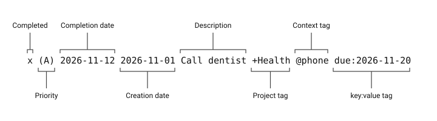

# The todo.txt format

Plain Todo stores your tasks in the todo.txt format: an ordinary UTF-8 text
file with one task on each line. Any text editor can open it, and other
todo.txt applications can read and change the same file.

This page summarizes the parts of the format that Plain Todo uses. The format
itself is maintained by the todo.txt community; see the
[todo.txt format reference](https://github.com/todotxt/todo.txt) for the
original description.

## A task line at a glance



Only the description is required. Every other part is optional, but the parts
you use must appear in the order shown.

```text
Buy milk
(A) 2026-11-01 Call dentist +Health @phone due:2026-11-20
x 2026-11-12 2026-11-01 Call dentist +Health @phone due:2026-11-20
```

## Open tasks

| Part | Example | Rule |
| --- | --- | --- |
| Priority | `(A)` | An uppercase letter in parentheses, followed by a space, at the very start of the line. `(A)` is the most important. |
| Creation date | `2026-11-01` | A `YYYY-MM-DD` date directly after the priority, or first when there is no priority. |
| Description | `Call dentist` | The task itself. It can contain any text. |
| Project | `+Health` | A word starting with `+`, after a space. A task can have several. |
| Context | `@phone` | A word starting with `@`, after a space. It names where or how you do the task. A task can have several. |
| Key and value | `due:2026-11-20` | Extra information as `key:value` with no spaces. |

A priority or date written anywhere else is part of the description. In these
lines, nothing is read as a priority:

```text
Call dentist (A)
(a) Call dentist
(A)Call dentist
```

Projects and contexts need a space in front of them, so `name@example.com` and
`2+2` are plain text, not tags.

## Completed tasks

A completed task starts with a lowercase `x` and a space, followed by the date
it was completed. If the task had a creation date, it comes next.

```text
x 2026-11-12 Call dentist
x 2026-11-12 2026-11-01 Call dentist +Health @phone
```

An uppercase `X`, or an `x` that is not at the start of the line, does not
mark a task as completed.

## Keys Plain Todo understands

| Key | Meaning | Example |
| --- | --- | --- |
| `due` | The date the task is due. | `due:2026-11-20` |
| `t` | The threshold date: the day you intend to start. | `t:2026-11-15` |

Other `key:value` pairs stay in the task line as written, even though Plain
Todo has no dedicated control for them.

## Why the order matters

Because the priority and dates come first, sorting the lines of the file
alphabetically in any text editor also sorts your tasks sensibly: prioritized
tasks first, in priority order and then by date.

Return to the [User Manual](USER_MANUAL.md) for how each Plain Todo app adds,
edits, and archives tasks.
